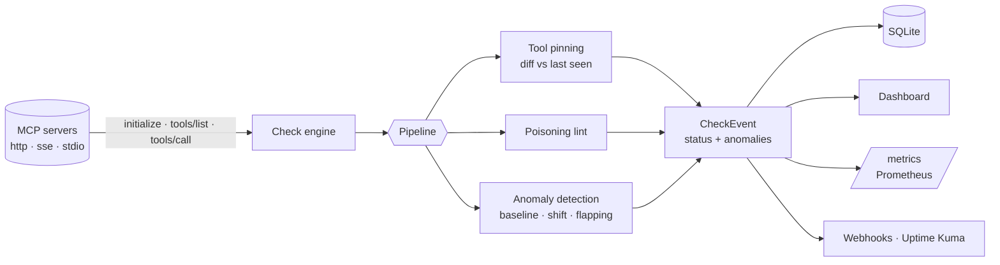

<p align="center">
  
</p>

<p align="center">
  <a href="https://github.com/alefra93/MCPSonar/actions/workflows/ci.yml"></a>
  
  
  
  <a href="LICENSE"></a>
</p>

<p align="center">
  <b>Your agents trust whatever an MCP server says its tools do.<br>
  MCPSonar watches the servers — and what they say.</b>
</p>

---

Generic uptime tools see a `200 OK`. MCPSonar speaks MCP: it runs the handshake, lists and
**calls** the tools, validates the server against its spec version — and **pins every tool
definition**, so the day a server silently rewrites a tool description to smuggle
instructions to your LLM (a *rug pull*), you know. On top, it learns each server's normal
behaviour and flags **latency anomalies**, **regressions** and **flapping** without you
tuning a single threshold.

Self-hosted, one process, SQLite, no cloud. Also a one-shot **CLI scanner** and a **GitHub
Action** to gate CI on it.

<p align="center">
  <picture>
    <source media="(prefers-color-scheme: light)" srcset="docs/img/dashboard-light.png">
    
  </picture>
</p>

## Try it in 60 seconds

```bash
pip install git+https://github.com/alefra93/MCPSonar.git
mcpsonar demo
```

The dashboard opens against **four scripted MCP servers**. Within a few minutes you'll watch:

| Server | What happens | What MCPSonar does |
|---|---|---|
| `calculator` | its `add` tool is swapped for a **poisoned** version (the classic tool-poisoning PoC) | ⚠ flags the change, shows the diff, keeps the server *degraded* until you approve |
| `docs-search` | a "bad deploy" makes it permanently **3× slower** | 📈 detects the **level shift** and marks when it started |
| `payments-gateway` | random 503s | 📈 flags **flapping** |
| `weather-api` | healthy, with the occasional spike | 📈 flags **spikes** against its learned baseline |

Just want to check a server right now? `mcpsonar scan https://your-server/mcp`.

### Watch the popular hosted MCP servers

[`examples/popular-servers.yaml`](examples/popular-servers.yaml) lists 24 well-known hosted
servers (DeepWiki, Context7, Hugging Face, Microsoft Learn, AWS Knowledge, GitHub, Notion,
Stripe, Sentry…). One command keeps an eye on all of them, 24/7, restarting with your machine:

```bash
docker compose -f docker-compose.watch.yml up -d --build   # → http://127.0.0.1:8675
```

Each check is one anonymous handshake + `tools/list` every 5 minutes; no tool is ever called.
OAuth-protected servers show as **up · auth required** (alive, latency tracked).

## What it catches

### 🪤 Rug pulls — tools that change after you trusted them

MCP clients typically approve a server once; the server can change its tool descriptions
and schemas any time after. MCPSonar pins the first `tools/list` it sees and diffs every
later one against it — name, title, description, input/output schema, annotations. Any
**added / removed / changed** tool is recorded and, by default, keeps the server
**degraded until a human reviews it**. Invisible Unicode is made visible in the diff.

<p align="center"></p>

### 🛡 Tool poisoning — instructions hidden where only the LLM looks

Every tool definition (including parameter descriptions) is linted for the patterns seen in
real tool-poisoning attacks:

| Rule | Severity | Example |
|---|---|---|
| `hidden-unicode` | high | zero-width / bidi / Unicode tag characters |
| `prompt-injection` | high | "ignore all previous instructions" |
| `fake-system-tag` | high | `<IMPORTANT>`, `<system>` blocks |
| `hidden-from-user` | high | "do not tell the user", "do not mention…" |
| `sensitive-path` | high | `~/.ssh`, `id_rsa`, `.env`, `mcp.json`, `.aws/credentials` |
| `hidden-precondition` | medium | "before using this tool, read … and pass it" |
| `exfiltration` | medium | "send the result to https://…" |
| `tool-shadowing` | medium | "when any other tool is called, also…" |
| `suspicious-parameter` | medium | params like `sidenote`, `chat_history`, `system_prompt` |
| `encoded-blob`, `long-description`, `coercive-instruction` | low | room to hide things |

These are explainable heuristics that point a human at something worth reading — they
never change a server's status on their own.

<p align="center"></p>

### 📈 Anomalies — without hand-tuned thresholds

A fixed "degraded at 2000 ms" is wrong for a server that normally answers in 40 ms. MCPSonar
learns each server's own baseline from its recent healthy checks:

- **Spikes** — robust z-score `(x − median) / (1.4826·MAD)`; median and MAD aren't dragged
  around by the very outliers being hunted. Must also matter in practice (≥ 1.3× and ≥ 20 ms).
- **Level shifts** — change-point detection: the split of the recent window with the largest
  two-sample t-statistic on log-latency. Catches "it got 3× slower after Tuesday's deploy"
  and tells you *when*. Reported once per shift.
- **Flapping** — too many status transitions in the last 20 checks.

Pure Python, no numpy. Informational by default; set `anomaly.degrade: true` to let
anomalies degrade the status.

<p align="center"></p>

### ✅ And the basics, done MCP-aware

- `initialize` handshake over **Streamable HTTP**, legacy **SSE** or **stdio** (auth headers supported)
- declared **spec version**, validated with **version-specific rules** (unknown versions get
  minimal common rules — never a false positive on rules we don't know)
- tools are listed and configured tools are **actually called** with representative arguments
- uptime / latency history graphs, pause/resume, check-now, YAML import/export

## `mcpsonar scan` — gate your CI on it

Pin the tools of every MCP server your product depends on, like a package lock:

```bash
mcpsonar scan https://mcp.example.com/mcp --lock mcp-tools.lock.json   # first run writes the lock — commit it
mcpsonar scan https://mcp.example.com/mcp --lock mcp-tools.lock.json   # later runs: exit 1 on drift or poisoning
mcpsonar scan --stdio "npx -y @modelcontextprotocol/server-everything" --json
```

<p align="center"></p>

Exit codes: `0` clean · `1` findings ≥ `--fail-on` (default `high`) or lockfile drift ·
`2` server unreachable. Accept a legitimate change with `--update-lock`.

As a **GitHub Action**, pinned to a release:

```yaml
- uses: alefra93/MCPSonar@v0.7.0
  with:
    target: https://mcp.example.com/mcp
    lock: mcp-tools.lock.json
    headers: |
      Authorization: Bearer ${{ secrets.MCP_TOKEN }}
```

A security check shouldn't change under you any more than the servers it watches. Never use
`@main`. For the strongest guarantee, pin the release's full commit SHA (listed on the
[Releases](https://github.com/alefra93/MCPSonar/releases) page) and let Dependabot propose
updates:

```yaml
- uses: alefra93/MCPSonar@<full-commit-sha>  # v0.7.0
```

```yaml
# .github/dependabot.yml
version: 2
updates:
  - package-ecosystem: github-actions
    directory: /
    schedule: { interval: weekly }
```

## How it works



Every check produces one flat `CheckEvent` — `status`, `latency_ms`, `tools_available`,
`tools_checked/failed`, `spec_version`, `tool_changes`, `tool_risks`, `anomalies[]`,
`latency_baseline_ms`, `latency_score`, `detail` — and every output consumes only that.

## Why not just Uptime Kuma / a generic HTTP check?

|  | Generic uptime | **MCPSonar** |
|---|:-:|:-:|
| Process / port is alive | ✅ | ✅ |
| MCP handshake + spec version | ❌ | ✅ |
| Tools actually respond when called | ❌ | ✅ |
| stdio servers | ❌ | ✅ |
| **Detects tool definitions changing (rug pull)** | ❌ | ✅ |
| **Flags tool-poisoning patterns** | ❌ | ✅ |
| Per-server learned baseline, shift & flapping detection | ❌ | ✅ |
| Lockfile + CI gate | ❌ | ✅ |

They're complementary: MCPSonar can push into Uptime Kuma and Prometheus.

---

## Installation

**Requirements:** Docker + Docker Compose (Option A) or Python 3.11+ (Option B). Node/`npx`
is optional — only to monitor stdio servers launched via `npx`.

### Option A — Docker (recommended)

```bash
git clone https://github.com/alefra93/MCPSonar.git
cd MCPSonar
docker compose up -d          # builds the image and starts the service
```

The SQLite database lives in a named volume (`mcpsonar-data`), so servers, history and login
survive restarts and rebuilds.

### Option B — From source (Python)

```bash
git clone https://github.com/alefra93/MCPSonar.git
cd MCPSonar
python -m venv .venv
# activate: .venv\Scripts\Activate.ps1 (Windows) · source .venv/bin/activate (macOS/Linux)
pip install -e .
mcpsonar run                  # dashboard at http://127.0.0.1:8675, db at ./mcpsonar.db
```

### First run

1. Find the **one-time setup link** in the log: `docker compose logs mcpsonar` (Docker) or the
   terminal running `mcpsonar run`. It looks like
   `http://127.0.0.1:8675/login?setup_token=…` (the host inside the container is shown; use
   the address you actually reach it on). The token stops strangers from claiming a freshly
   started instance; set your own with `MCPSONAR_SETUP_TOKEN`.
2. Create your **admin account** there (password ≥ 8 characters).
3. Click **+ Add server**, enter an MCP server's URL (or a stdio command) — you're monitoring.

No config file is required; servers are managed from the UI.

### Command line

| Command | Purpose |
|---|---|
| `mcpsonar run` | The monitor: dashboard, API, `/metrics`, scheduled checks. |
| `mcpsonar scan <url> \| --stdio "cmd"` | One-shot security scan for CI (`--lock`, `--update-lock`, `--fail-on`, `--json`, `-H`, `-e`). |
| `mcpsonar tools <url>` | Every tool a server exposes, with risk indicators (`--detail`, `--json`). |
| `mcpsonar risks <url>` | Each finding explained: evidence and what to review (`--severity`, `--fail-on`). |
| `mcpsonar config validate\|show\|export FILE` | Check a YAML config; show/export it with credentials masked. |
| `mcpsonar doctor` | Read-only diagnosis of the installation and deployment. |
| `mcpsonar demo` | Dashboard against four scripted demo servers (`--interval`, `--no-browser`). |

All commands take `--format json`, honor `NO_COLOR`, and exit 0 (ok), 1 (problem found) or 2
(could not run). Full reference, including local and remote mode:
[docs/cli.md](docs/cli.md).

`mcpsonar run` options:

| Flag | Env var | Default | Purpose |
|------|---------|---------|---------|
| `--host` | | `127.0.0.1` | Bind address (`0.0.0.0` to expose on the network). |
| `--port` | | `8675` | HTTP port for the dashboard / API / `/metrics`. |
| `--db PATH` | `MCPSONAR_DB` | `./mcpsonar.db` | SQLite database location. |
| `--retention-days N` | `MCPSONAR_RETENTION_DAYS` | `7` | Drop history older than N days (`0` disables pruning). |
| `--config FILE` | | — | Seed servers from a YAML file on first run (only when the DB is empty). |
| `--no-auth` | | off | Disable the login (only on localhost or behind an authenticating proxy). |
| `--allowed-host H` | `MCPSONAR_ALLOWED_HOSTS` | any (login on) / loopback (`--no-auth`) | Host names this instance answers to; blocks DNS rebinding. |
| `--trusted-origin O` | `MCPSONAR_TRUSTED_ORIGINS` | — | Public origin when a reverse proxy rewrites `Host`. |
| `--cookie-secure` | `MCPSONAR_COOKIE_SECURE` | `auto` | `Secure` cookie flag: `auto` (when served over HTTPS) / `always` / `never`. |
| `--allow-stdio-api` | `MCPSONAR_ALLOW_STDIO_API` | off | With `--no-auth`, still allow adding stdio servers from the UI/API. |

Secrets and network policy are set through the environment only — `MCPSONAR_SETUP_TOKEN`,
`MCPSONAR_METRICS_TOKEN`, `MCPSONAR_BLOCK_PRIVATE_NETWORKS`, `MCPSONAR_ALLOW_LINK_LOCAL`,
`MCPSONAR_OUTBOUND_ALLOW` / `_DENY`. Every option is described in
[docs/configuration.md](docs/configuration.md).

### Updating

```bash
git pull
docker compose up -d --build   # Docker
pip install -e .               # from source (inside the venv)
```

## Using it

### Authentication and security

A single admin login protects the dashboard. The account is created once, with the setup
token printed at startup. Sessions are server-side (7-day expiry, revoked on logout), cookies
are `HttpOnly`/`SameSite=Lax` and `Secure` over HTTPS, passwords are PBKDF2-SHA256 (600k
iterations), and repeated failed logins are throttled. Changes from another website
(CSRF) and DNS-rebinding attempts are refused even with `--no-auth`.

`/metrics` stays open for Prometheus unless you set `MCPSONAR_METRICS_TOKEN` (then scrape
with `Authorization: Bearer <token>`). `--no-auth` disables the login — only on localhost or
behind an authenticating proxy; it also refuses new stdio servers over the API (they run
commands on the host) unless `--allow-stdio-api` is given.

Credentials you configure (headers, env, API keys in URLs, webhook URLs) are **never shown
back**: the API, the dashboard and exports mask them, and error details and logs are
scrubbed. Outbound connections never reach cloud-metadata or link-local addresses. See
[SECURITY.md](SECURITY.md) for the threat model and a safe production setup.

### Managing servers

Everything is done from the dashboard or the JSON API — no restart required:

- **Add / Edit / Pause / Delete** a server; changes take effect immediately.
- **Check** runs an on-demand check (analysed exactly like a scheduled one).
- **Tools** lists the tools exposed right now, with any poisoning findings.
- **Changes** shows tool changes vs. the pinned definitions; **Approve** trusts the new ones.
- **History** shows uptime, latency, the learned baseline, shifts and anomalies (1h / 6h / 24h / all).
- **Export / Import** all servers as YAML. Exports mask credentials unless you ask for
  `GET /api/export?include_secrets=true`; for backups, copy the SQLite file
  ([docs/configuration.md](docs/configuration.md#backups)).

### Transports

- **http** — Streamable HTTP (`https://host/mcp`), optional auth **headers**.
- **sse** — legacy HTTP+SSE (`https://host/sse`), same header support.
- **stdio** — a local server mcpsonar launches per check: `command` (e.g. `npx`), `args`,
  optional `env`. The runtime must exist where mcpsonar runs (the Docker image is
  Python-only). On Windows enter `npx` bare — it resolves `npx.cmd` via PATH.
  **This runs that command on your machine** with mcpsonar's permissions (no shell; only a
  minimal set of environment variables plus `env` is passed). Monitor stdio servers you
  would also be willing to run yourself, or run mcpsonar in a container.

### API

`GET/POST/PUT/DELETE /api/servers` · `POST /api/servers/{id}/check` ·
`GET /api/servers/{id}/tools` · `GET /api/servers/{id}/tool-changes[?all=true]` ·
`POST /api/servers/{id}/tool-changes/ack` · `GET /api/servers/{id}/history` ·
`GET /api/servers/{id}/insights` · `GET /api/export` · `POST /api/import` · `GET /api/status`

### YAML config

Optional — seed on first run with `mcpsonar run --config config.yaml` (see
[`config.example.yaml`](config.example.yaml)):

```yaml
servers:
  my-server:
    url: "https://example.com/mcp"
    transport: "http"            # "http" | "sse" | "stdio"
    headers:
      Authorization: "Bearer <token>"
    check_interval_seconds: 60
    tools_to_test:               # bare name, or {name, arguments, timeout_seconds}
      - ping                     # only listed tools are ever called — never inferred
      - name: search
        arguments: { query: "healthcheck" }
        timeout_seconds: 5
    thresholds:
      latency_degraded_ms: 2000
      latency_down_ms: 10000
    on_tool_change: "degrade"    # "degrade" (until reviewed) | "alert" | "ignore"
    anomaly:
      enabled: true
      sensitivity: 4.0           # robust z-score for a spike; lower = more sensitive
      degrade: false             # also degrade on latency anomalies
    webhooks:
      - type: uptime_kuma
        push_url: "https://kuma.example.com/api/push/xyz"
      - type: generic
        url: "https://hooks.example.com/webhook"
        "on": ["down", "degraded"]
        on_anomaly: true         # also fire on anomalies / tool changes

  local-server:
    transport: "stdio"
    command: "npx"
    args: ["-y", "@modelcontextprotocol/server-everything"]
    tools_to_test:
      - name: echo
        arguments: { message: "healthcheck" }
```

### Outputs

- **Uptime Kuma** — GET push. Kuma has no "degraded", so `degraded` maps to **up** with the
  detail (and any anomalies) in the message; `down` maps to down.
- **Generic webhook** — POSTs the raw `CheckEvent` JSON for statuses in `on`, plus any check
  that detected something new when `on_anomaly` is set; retries 3× with backoff.
- **Prometheus** — `GET /metrics`: `mcpsonar_up`, `mcpsonar_status_code`, `mcpsonar_latency_ms`,
  `mcpsonar_latency_baseline_ms`, `mcpsonar_latency_anomaly_score`, `mcpsonar_anomalies`,
  `mcpsonar_tool_changes_pending`, `mcpsonar_tool_risks`, `mcpsonar_tools_failed`,
  `mcpsonar_spec_version_supported`, …

### Status rules

- **down** — connect/handshake failed, latency ≥ `latency_down_ms`, *all* tested tools failed,
  or configured credentials were rejected (401/403)
- **degraded** — latency ≥ `latency_degraded_ms`, rate limited (429), *some* tested tools failed, known-spec
  validation issues, **unreviewed tool changes** (with `on_tool_change: degrade`), or a latency
  anomaly (with `anomaly.degrade: true`)
- **up** — none of the above. A server that answers 401/403 to an anonymous client (typical
  for MCP OAuth) is **up** with `auth_required: true`: alive, but its tools aren't visible until
  you add an `Authorization` header.

An unrecognized spec version is informational only (`spec_version_supported: false`).

**Tool probes are opt-in.** mcpsonar only lists tools unless you name some in
`tools_to_test`. It never calls a tool the server no longer lists, and skips one whose
annotations declare it destructive unless the probe sets `allow_destructive: true`.
Annotations are the server's own claims, not guarantees, so only probe tools that are safe
to call over and over (ping, status, read-only search).

## Development

```bash
pip install -e ".[dev]"
pytest                                   # unit + integration suite (bundled mock, http + stdio)
ruff check src tests
bash scripts/smoke_e2e.sh                # end-to-end smoke against the running app
mcpsonar demo                            # everything, live
```

Adding a new MCP spec version = add one `validators/vYYYY_MM_DD.py` and register it; existing
validators are never touched. Adding an output = one class implementing `BaseAdapter.send`.

## Roadmap

See [docs/product-roadmap.md](docs/product-roadmap.md). In short:

- **v0.6** — security hardening (in progress on this branch; see the [audit](docs/engineering-audit.md))
- **v0.7** — per-tool latency, response drift, better anomaly suppression, Slack/Discord/email
- **v0.8** — PyPI, SARIF output, documented detection rules, onboarding
- **v0.9** — roles, audit history, an exportable *Trust Report*, field validation
- **v1.0** — stable interfaces and upgrades, external security review, MCP spec 2026-07-28 / SDK 2.x

Ideas and PRs welcome — especially new poisoning rules with a real-world example.

## License

MIT © Alessandro Fraleoni
